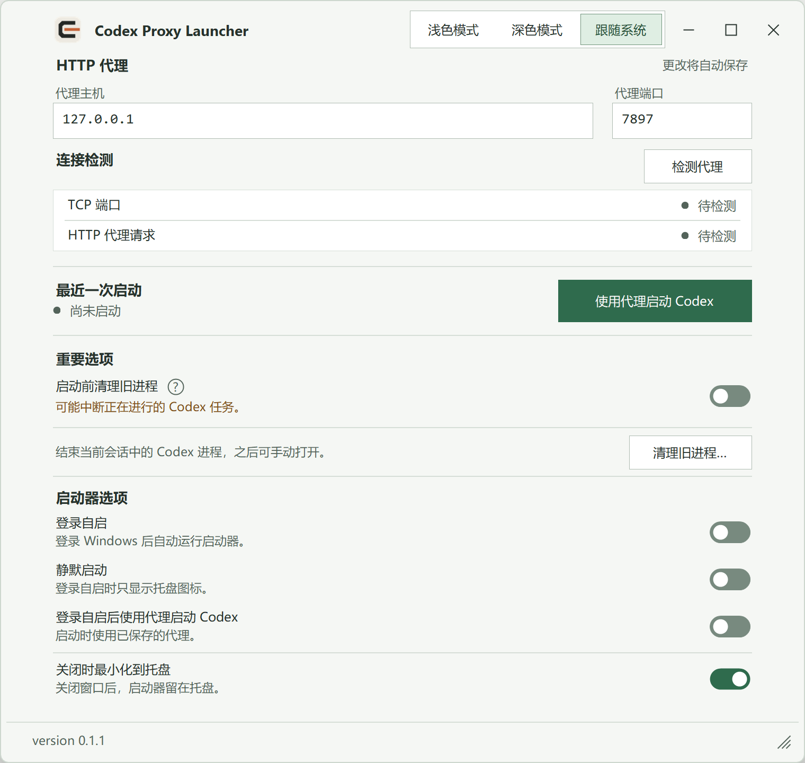

# CodexProxyLauncher

Windows 11 x64 上的 Codex Desktop HTTP 代理启动器。可从设置窗口、PowerShell 或 Windows 快捷方式启动 Codex 桌面版。

HTTP proxy launcher for Codex Desktop on Windows 11 x64.

[下载 Windows 版 · Download for Windows](https://github.com/Randolfluo/CodexProxyLauncher/releases)

可在本地浏览器中试用设置窗口、托盘菜单和关键状态。[界面交互预览](docs/ui-preview.html)



## 安装

先安装 Microsoft Store 版 Codex Desktop，并准备可用的 HTTP 代理。两个版本均使用系统自带的 Windows PowerShell。

| 版本 | 下载文件 | Windows 11 x64 运行时 |
| --- | --- | --- |
| 轻量版 | `CodexProxyLauncher-<version>-win-x64-net48.exe` | 21H2 自带 .NET Framework 4.8，22H2 及更新版自带 4.8.1，均满足轻量版要求。[微软说明](https://learn.microsoft.com/zh-cn/dotnet/framework/get-started/system-requirements#client-operating-systems) |
| 完整版 | `CodexProxyLauncher-<version>-win-x64-net10.exe` | 内置 .NET 10 桌面运行时。[Windows 版本要求](https://learn.microsoft.com/zh-cn/dotnet/core/install/windows#supported-versions) |

将下载的 EXE 放在固定目录后双击打开。EXE 未签名，可用 `Get-FileHash -Algorithm SHA256` 计算哈希，与对应的 `.exe.sha256` 文件核对。

## 配置 Codex Desktop 的 HTTP 代理

双击 EXE 打开设置，窗口底部显示启动器版本。填写代理主机和端口，默认地址为 `http://127.0.0.1:7897`。有效设置会自动保存。点击「检测代理」可检查 TCP 端口和经代理访问 `api.openai.com` 的结果。点击「使用代理启动 Codex」后，界面会显示发起启动的本地时间和 Windows 的响应。

「重要选项」里的**启动前清理旧进程**默认关闭。开启后，启动器会在按当前代理设置重新启动 Codex 前结束旧实例，可能中断正在运行的任务。选项旁的问号可查看说明。

点击下方的**清理旧进程…**并确认，可结束当前 Windows 会话中的 Codex 进程。完成后可在需要时手动打开 Codex。

在「启动器选项」中可独立设置窗口行为和自启。

- **登录自启**默认关闭。开启后，Windows 登录时自动运行启动器。
- **静默启动**默认关闭。开启后，登录自启时启动器只在系统托盘运行。单击托盘图标或双击 EXE 可打开设置。
- **登录自启后使用代理启动 Codex**默认关闭。开启后，登录自启时使用已保存的代理启动 Codex。双击 EXE 打开设置后，可按需点击启动按钮。
- **关闭时最小化到托盘**默认开启。关闭此选项后，点关闭按钮或按 Alt+F4 会退出启动器。托盘图标的右键菜单也可退出。

如果原来登记的 EXE 已被删除，将新版 EXE 放在固定目录并双击一次，启动器会把失效的登记更新为当前路径。如果登记指向另一份仍存在的 EXE，可在需要自启的版本里关闭再开启登录自启。Windows 的「设置 → 应用 → 启动」也可管理该启动项。

### 命令行与快捷方式

两种方式都可启动 Codex 一次。`--proxy` 指定本次使用的代理，省略时使用内置默认地址 `http://127.0.0.1:7897`。

在 EXE 所在目录打开 PowerShell，将文件名和代理地址换成实际值。

```powershell
.\CodexProxyLauncher-0.1.1-win-x64-net48.exe --launch --proxy http://127.0.0.1:7890
```

创建 Windows 快捷方式，在「属性 → 目标」中填写带引号的实际 EXE 路径，后接空格和参数。

```text
"C:\Tools\Codex Proxy Launcher\CodexProxyLauncher-0.1.1-win-x64-net48.exe" --launch --proxy http://127.0.0.1:7890
```

Codex 已运行时，启动器默认提示先退出旧实例。添加 `--restart-running` 会强制结束旧进程后重新启动，可能中断正在运行的任务。

## 从源码构建

在 Windows x64 上使用 PowerShell 7 和 `global.json` 指定的 .NET 10 SDK。在仓库根目录运行以下命令。[SDK 配置](global.json)

```powershell
.\scripts\build.ps1 -Action Package && .\scripts\build.ps1 -Action Publish
```

`Package` 生成轻量版 ZIP，`Publish` 生成完整版 EXE。运行 `.\scripts\verify-release.ps1` 可构建并验证两个发布版本。[构建说明](scripts/README.md) · [测试说明](tests/README.md)

## 来源与许可

项目采用 MIT 许可。桌面代理启动方案参考 Double Young（microyy）的《Codex Desktop 代理配置实践》（CC BY 4.0）。[MIT 许可](LICENSE) · [第三方来源说明](THIRD_PARTY_NOTICES.md)
